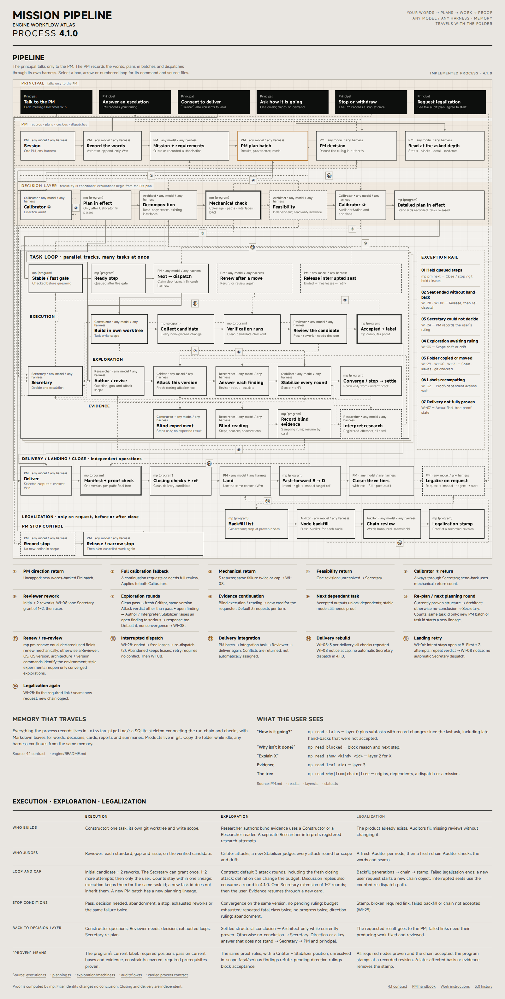
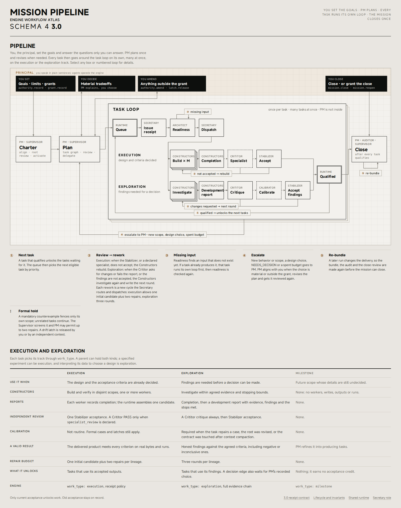

# Mission Pipeline

Mission Pipeline runs a software project as a traceable process that any agent harness and any model can carry out. You talk to one PM, the session on your screen. Seats, filled by whatever harness and model the PM chooses, plan, build, review and attack the work, and every step is kept in a memory that lives in your project folder. Version 4.1 is in [`engine/`](engine/).

[](https://zhuoqiumcgill.github.io/mission-pipeline/workflow-4.1.html)

[Interactive workflow](https://zhuoqiumcgill.github.io/mission-pipeline/workflow-4.1.html): explore the pipeline, select example tasks, walk their seat lanes and replay recovery scenarios. The page is [docs/workflow-4.1.html](docs/workflow-4.1.html); regenerate the image with `python tools/render_workflow.py --page docs/workflow-4.1.html --out docs/workflow-4.1-light.png`.

## What it is

Three parts, and nothing else:

- **An objective project memory**, in `<project>/.mission-pipeline/`. A SQLite database is the skeleton: the complete run chain (who handed which task to whom, on which version), every state, the links between versions, the result of every program check. Markdown files are the leaves: your words, decisions and their reasons, plans, each seat's card and report, run summaries. Copy the folder to another machine and continue with any harness.
- **Role descriptions**: one page per seat: what it does, what it receives and hands back, which `mp` commands it uses.
- **A process**: who comes after whom, what counts as accepted, what goes to you, how explorations are attacked and kept on course by a Stabilizer.

`mp`, a command line, is the only way to read and write the memory. It starts no seats and runs no service: the PM dispatches seats through its own harness.

## Key ideas

- **A seat is a role, not a model.** Calibrators check the plan against your words, an Architect breaks it into tasks, Constructors build them in their own git worktrees, Reviewers accept them, Researchers and Crititors run explorations with a Stabilizer after every attack round, a Secretary decides escalations within your authority, an Auditor legalizes a lineage when you ask. Any model in any harness can fill any seat; who filled it is recorded and invalidates nothing.
- **Your words are the root.** The PM records every message verbatim as a words entry; requirement items must quote it verbatim. `mp read why <anything>` walks from a delivered commit back to the words it rests on.
- **Proof is the program's.** Verification runs on a clean checkout of the candidate commit; the labels (proven, not fully proven, refuted, …) are computed from the records and stored. Only important design decisions come back to you.
- **Stops take effect at once.** `mp pm stop` is written before anything else; nothing in its scope is dispatched, accepted or landed afterwards.
- **Landing never merges.** A delivery fast-forwards your target branch from the base it was proven on, or leaves a delivery ref for you.
- **Security, logins and spending are your harness's business.** No sandbox, no credentials, no metering.

## Quick start

You need Node 22.12 or later and git, on Linux, Windows or macOS.

```sh
git clone https://github.com/ZhuoQiuMcgill/mission-pipeline.git
cd mission-pipeline/engine
npm install
npm install -g .        # links the `mp` command to this folder
cd /path/to/your/project
mp init --pointer both  # adds one line to CLAUDE.md and AGENTS.md pointing the PM to its handbook
```

Then open your project with any agent harness (Claude Code, Codex, …) and tell it what you want. It acts as the PM: it reads `.mission-pipeline/pm/PM.md`, runs `mp pm session --filled-by "<harness>/<model>"`, and works through `mp pm next`.

## Documentation

- [engine/README.md](engine/README.md): install, `mp init`, the PM's loop, seats, the memory folder, the tree reads, platforms and known limitations.
- [`docs/design/DesignDoc_MissionPipeline_4.1_2026-10-10_v06.md`](docs/design/DesignDoc_MissionPipeline_4.1_2026-10-10_v06.md): the design contract.
- [CHANGELOG.md](CHANGELOG.md).

## Earlier versions

4.0 (a Claude Code plugin with a ledger service and sandboxed seats) is at tag [v4.0.0](https://github.com/ZhuoQiuMcgill/mission-pipeline/tree/v4.0.0); 3.x at [v3.0.0](https://github.com/ZhuoQiuMcgill/mission-pipeline/tree/v3.0.0). 4.1 does not read 4.0 ledgers.

### The 3.0 workflow (historical)

This page and image show the 3.0 process. 4.1 changed the seats and the process (see the design contract).

[](https://zhuoqiumcgill.github.io/mission-pipeline/workflow-3.0.html)

[Interactive 3.0 workflow](https://zhuoqiumcgill.github.io/mission-pipeline/workflow-3.0.html): select tasks, walk one task's cycle seat by seat and replay recovery scenarios. The page is [docs/workflow-3.0.html](docs/workflow-3.0.html); after editing it, regenerate the image with `python tools/render_workflow.py`.

[MIT](LICENSE) © 2026 Zhuo Qiu
