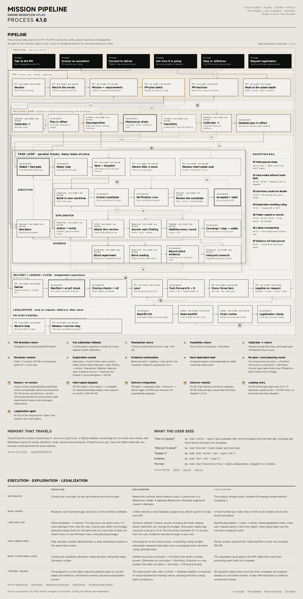
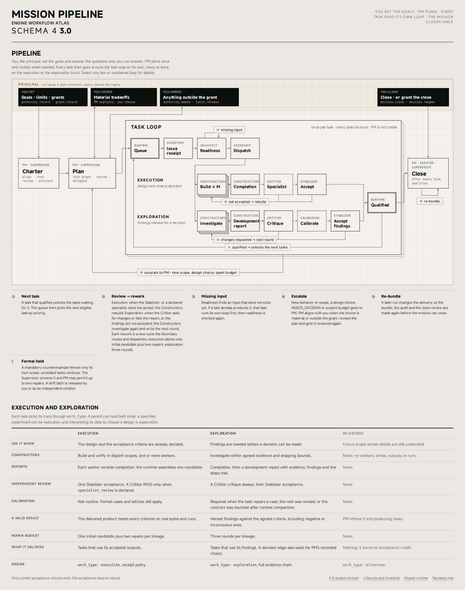

# Mission Pipeline

Mission Pipeline exists so that agents produce results that are responsible to the user.
You talk to one PM, your anchor: it understands your logic and needs, keeps the plan aligned and makes big decisions on your recorded words.
A resident Secretary runs the loop, dispatches seats, handles exceptions and decides most field matters within the plan.
Version 4.3.0 is in [`engine/`](engine/).

[](https://zhuoqiumcgill.github.io/mission-pipeline/workflow-4.1.html)

[Interactive 4.1 workflow (before the 4.3 role split)](https://zhuoqiumcgill.github.io/mission-pipeline/workflow-4.1.html): explore the pipeline, select example tasks, walk their seat lanes and replay recovery scenarios. The page is [docs/workflow-4.1.html](docs/workflow-4.1.html); regenerate the image with `python tools/render_workflow.py --page docs/workflow-4.1.html --out docs/workflow-4.1-light.png`.

## What it is

Three parts, and nothing else:

- **An objective project memory**, in `<project>/.mission-pipeline/`. A SQLite database is the skeleton: the complete run chain (who handed which task to whom, on which version), every state, the links between versions, the result of every program check. Markdown files are the leaves: your words, decisions and their reasons, plans, each seat's card and report, run summaries. Copy the folder to another machine and continue with any harness.
- **Role descriptions**: one page per seat: what it does, what it receives and hands back, which `mp` commands it uses.
- **A process**: who comes after whom, what counts as accepted, what goes to the PM and when it asks you, how explorations are attacked and kept on course by a Stabilizer.

`mp`, a command line, is the only way to read and write the memory. It starts no seats and runs no service: the Secretary dispatches seats through its own harness.

## Key ideas

- **A seat is a role, not a model.** Calibrators check the plan against your words, an Architect breaks it into tasks, Constructors build them in their own git worktrees, Reviewers accept them, Researchers and Crititors run explorations with a Stabilizer after every attack round, the resident Secretary decides within the plan, an Auditor legalizes a lineage when you ask. Any model in any harness can fill any seat; who filled it is recorded and invalidates nothing.
- **Your words are the root.** The PM shows its reading of your message type, then records it verbatim after your next message raises no objection; one-off instructions record at once, unrelated messages never do; requirement items must quote it verbatim. `mp read why <anything>` walks from a delivered commit back to the words it rests on.
- **Proof is the program's.** Verification runs on a clean checkout of the candidate commit; the labels (proven, not fully proven, refuted, …) are computed from the records and stored. The PM decides big questions on recorded words and asks you when those words do not support a choice and impact is major.
- **Your words settle what you decided.** The PM carries your decision out on your words and records it; it is not sent back through a review or refused for form. You may waive a mission's plan reviews (`mp pm waive`), accept a verified task or an exploration's result with its risks, or change an exploration's method directly (`mp pm repair` with a change form). Every place where the process stops has an exit your words can take: accept, change, run again or drop. Details stay with the Secretary; PM-class decisions go to the PM inbox.
- **You guide the direction; you never accept details.** The PM reports when the work is done. You try the result and name what to repair (`mp pm repair`), or say "close and merge" once: `mp pm finish` delivers, lands and closes on those words. Closing never refuses: the record says what is proven, what is not, and whether the full suite ran on the delivered tree.
- **Explorations end by their state.** An exploration converges in the round its Stabilizer judges on track with nothing fatal or serious left open and no direction question waiting, the budget's last round included. Evidence may cite data outside the repository by path, sha256 and size; `mp` checks it at hand-back and labels it "outside the commit". Long experiment runs can run detached from the seat that started them.
- **The full suite runs where it matters.** Constructors run local tests. An integration task's Reviewer runs the project's full suite (`fullSuite` in `config.json`) last, once nothing visible is wrong; a failure reopens the task that caused it. Every full run leaves a marker, and the PM decides with you whether another run is worth it before closing.
- **Stops take effect at once.** `mp pm stop` is written before anything else; nothing in its scope is dispatched, accepted or landed afterwards.
- **Landing never merges.** A delivery fast-forwards your target branch from the base it was proven on, or leaves a delivery ref for you.
- **Security, logins and spending are your harness's business.** No sandbox, no credentials, no metering.

## Quick start

You need Node 22.12 or later and git, on Linux, Windows or macOS.

```sh
git clone https://github.com/ZhuoQiuMcgill/mission-pipeline.git
cd mission-pipeline/engine
npm install
npm install -g .        # links the `mp` command to this folder
cd /path/to/your/project
mp init --pointer both  # adds one line to CLAUDE.md and AGENTS.md pointing the PM to its handbook
```

Then open the project with an agent harness and tell it what you want.
It reads `.mission-pipeline/pm/PM.md`, starts its PM session, and launches the resident Secretary with `mp pm secretary start`.
After an engine upgrade, run `mp docs update`, read the new PM core, and start the Secretary.
4.2 records fold without migration; without a live Secretary, the older loop names still work in 4.2 mode.

## How a harness acts as the PM

Read the PM core and run `mp pm session --filled-by "<harness>/<model>"` for bounded layer 1 and the inbox.
Record typed words under the deferred rule; before a PM-class decision, read subject layer 2 and all principles in force.
Decide big questions on recorded words; ask the user only without support and with major impact.
The minor-impact, no-words default is a PM decision with a reason, shown to the user so they can overrule.
A structural detailed-plan revision waits for the PM's `approve` or `send-back` answer to `plan-structure-change`.
The PM contacts the Secretary only for requested progress details (`mp pm ask-secretary`) or a new instruction (`mp pm note`).
It handles stops and delivery consent; it keeps dispatch detail out of its context.

## How a harness acts as the Secretary

Start the named resident `<project>-Secretary` with the printed prompt and `MP_SECRETARY=S-<n>`; bind its harness id with `mp pm secretary handle <S-n> <id>`.
It reads `.mission-pipeline/secretary/SECRETARY.md`, claims the generation with `mp sec session`, then loops on `mp sec next`, `mp sec dispatch` and `mp sec wait --since R`.
It starts sub-agents with the fixed prompt printed by dispatch and handles operational notices and WI pages.
It decides within the plan; PM-class choices use `needs-pm` / `ask-pm` and wait in the PM inbox.
It answers questions, takes no direct user instructions ("please tell the PM"), and does not report progress unasked.

**Claude Code 2.1.319 — to verify on your version:** `MP_SECRETARY=S-<n> claude --bg -n "<project>-Secretary" "<printed prompt>"` for launch; `claude attach` or `claude --resume` for access; `claude stop <id>` for shutdown.
Verify environment inheritance, sub-agent shutdown with the parent and sessions messaging each other; messages only wake the memory record.
See [engine harness notes](engine/README.md#harness-notes) for other harnesses and seats that outlive a parent.

**Limitations.** Work moves while the Secretary session runs; questions for the PM wait while no PM session is open, and other work continues.
An object constraint added during or after plan review can leave a proof gap; its PM inbox item requires new user words for either WI-34 exit.

## Documentation

- [engine/README.md](engine/README.md): install, `mp init` and `config.json` (`fullSuite`, `commit`, `shell`, `experimentShell`, `cleanupCommands`, `startOnHandback`), the PM and Secretary split, the resident loop, seats, the memory folder and its `tmp/` layout, the tree reads, harness notes, platforms and known limitations.
- [4.3 PM/Secretary design](docs/design/DesignDoc_PMSecretary_2026-11-06_v03.md): rulings F-1 to F-9; Appendix B wins over A and the base text.
- [`docs/design/DesignDoc_MissionPipeline_4.1_2026-10-10_v06.md`](docs/design/DesignDoc_MissionPipeline_4.1_2026-10-10_v06.md): the design contract.
- [CHANGELOG.md](CHANGELOG.md).

## Earlier versions

4.0 (a Claude Code plugin with a ledger service and sandboxed seats) is at tag [v4.0.0](https://github.com/ZhuoQiuMcgill/mission-pipeline/tree/v4.0.0); 3.x at [v3.0.0](https://github.com/ZhuoQiuMcgill/mission-pipeline/tree/v3.0.0). 4.3 does not read 4.0 ledgers.

### The 3.0 workflow (historical)

This page and image show the 3.0 process. 4.1 changed the seats and the process (see the design contract).

[](https://zhuoqiumcgill.github.io/mission-pipeline/workflow-3.0.html)

[Interactive 3.0 workflow](https://zhuoqiumcgill.github.io/mission-pipeline/workflow-3.0.html): select tasks, walk one task's cycle seat by seat and replay recovery scenarios. The page is [docs/workflow-3.0.html](docs/workflow-3.0.html); after editing it, regenerate the image with `python tools/render_workflow.py`.

[MIT](LICENSE) © 2026 Zhuo Qiu
